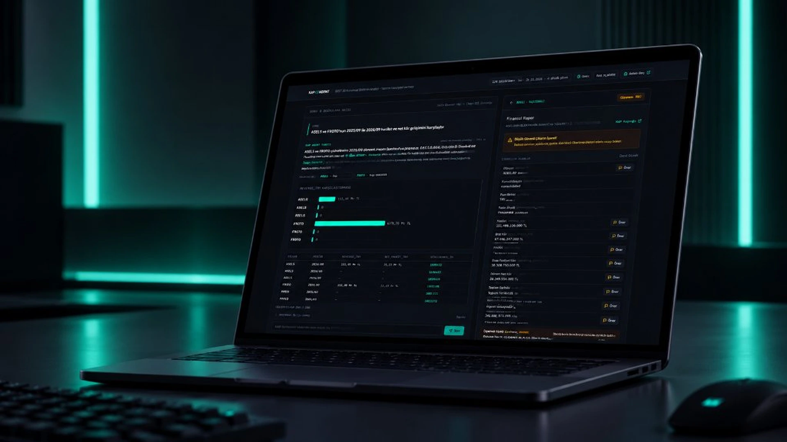
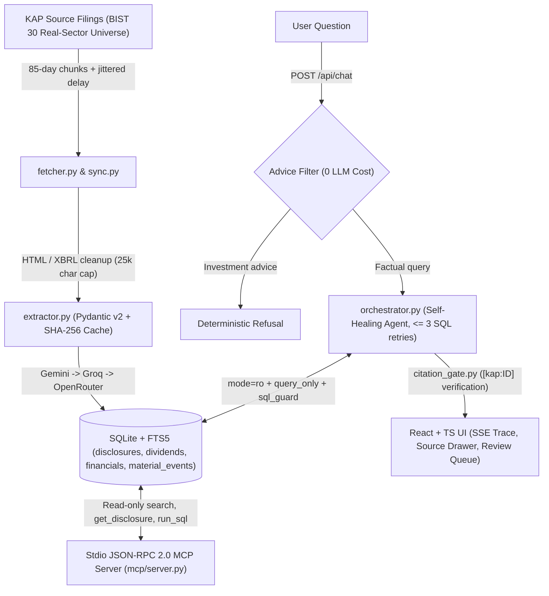
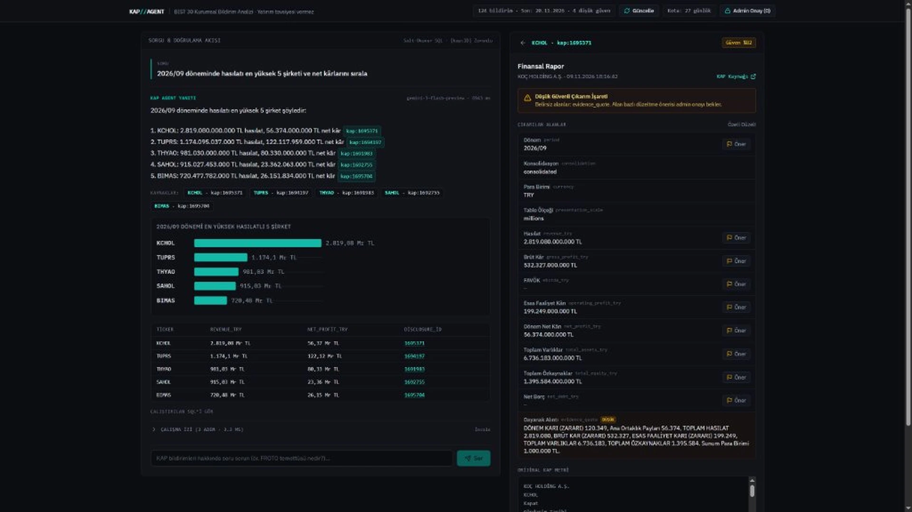
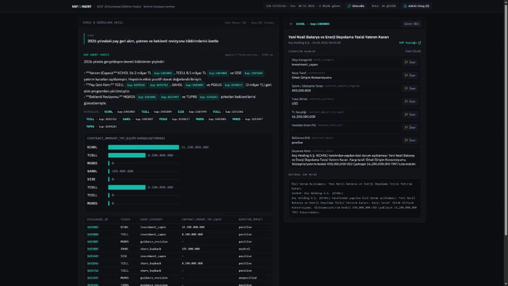

# KAP Agent — BIST Disclosure Analysis & Self-Healing SQL Agent

An evidence-grounded financial disclosure assistant that extracts BIST 30 KAP filings into SQLite + FTS5, executes self-healing read-only SQL queries, enforces `[kap:ID]` citation gating, and exposes the same tools over a stdio MCP server.

**[Live Demo](https://kap-agent.vercel.app/)** · **[Portfolio Case Study](https://kadircelikportfolyo.vercel.app/#projects)**



> **Disclaimer & Scope:** This project converts Public Disclosure Platform (KAP) filings into structured data and provides verifiable analysis linked to source disclosure IDs (`[kap:ID]`). It does **not** provide investment advice, price targets, or buy/sell recommendations.

---

## Architecture

To minimize hallucination risk and LLM inference cost, KAP Agent separates **offline structured extraction** from an **online read-only agent runtime**:



---

## Key Engineering Highlights & Trade-Offs

- **Offline Extraction Pipeline (`backend/app/pipeline/`)**: `fetcher.py` handles 85-day window chunking, jittered delays, local disk caching (`data/raw/`), and V1 bank filtering. `extractor.py` runs once per disclosure (cached via SHA-256) using `prepare_extraction_text` to strip boilerplate from `150+ KB` XBRL HTML filings while keeping income-statement and balance-sheet summaries inside a `25,000`-character limit. `FallbackChainProvider` switches cleanly across `Gemini -> Groq -> OpenRouter` with rate pacing (`llm_min_interval_sec`) and `429 Retry-After` backoff.
- **Read-Only Isolation & Self-Healing SQL (`backend/app/agent/`)**: Agent tools only read through `get_readonly_agent_conn` (`mode=ro`, `PRAGMA query_only = ON`, `1500ms` timeout). `sql_guard.py` enforces a single `SELECT` statement, blocks `;`, `--`/`/* */` comments, `WITH` CTEs, DDL/DML/`PRAGMA`, and `review_flags`/`sqlite_master` access, and caps results at `LIMIT <= 50`. When SQL fails, `orchestrator.py` passes the error and schema summary back to retry up to **3 times** (`max_sql_retries=3`).
- **Zero-Cost Guardrail & Citation Gating (`citation_gate.py`)**: Buy/sell and recommendation prompts are rejected before touching any LLM; every numeric answer must pass `[kap:ID]` verification against tool outputs and SQLite records before streaming to the client.
- **Correction Queue, Quotas & MCP Server (`backend/app/api/`, `backend/app/mcp/server.py`)**: User correction flags (`review_flags`) are HTML-sanitized, per-IP rate-limited, and queued as `pending` until approved with `X-Admin-Token`. Global `/api/*` sliding-window rate limits (`60 req/min` per IP), query caching, daily quotas, Demo Mode for curated questions, and a stdio JSON-RPC 2.0 MCP server (`search_disclosures`, `get_disclosure`, `run_sql`) for Claude Code, Antigravity, or Claude Desktop are built in.
- **Scope Boundaries & Trade-Offs**: Covers 18 non-bank BIST 30 companies (`THYAO`, `TUPRS`, `FROTO`, `ASELS`, `BIMAS`, `EREGL`, `SISE`, `TCELL`, `TTKOM`, `KCHOL`, `SAHOL`, `TOASO`, `ARCLK`, `MGROS`, `PGSUS`, `ENKAI`, `ASTOR`, `KONTR`). Banks (`GARAN`, `AKBNK`, `ISCTR`, `YKBNK`, `VAKBN`, `HALKB`, `TSKB`, `ALBRK`, `SKBNK`) are excluded in V1 due to BDDK balance-sheet schema differences. User accounts, vector DBs, fine-tuning, and multi-agent swarms are intentionally out of scope.

### Data Transparency & Verified Live Eval Results

- `data/sample_seed/` (24 filings: 8 dividend, 8 financial report, 8 material event) provides deterministic zero-setup CI test fixtures (`SYNTHETIC_SAMPLE_SEED`).
- The local DB (`data/kap_agent.db`, gitignored) indexes **185 real KAP disclosures** across the 18 companies (`2025-04-28` – `2026-11-19`), including **17/18** `2026/09` filers *(KONTR under SPK filing extension, `kap:1695620`)*, kept current by background incremental sync (`KAP_AUTO_SYNC_ENABLED=true`, 15-min interval, 45-day cold-start scan).
- `evals/extraction_gold.jsonl` (50 real filings) and `evals/agent_gold.jsonl` (30 real questions) were cross-checked against live `kap.org.tr/tr/Bildirim/<ID>` pages (`51/51 HTTP 200 OK`) and marked `"verified": true`. Eval scripts exclude unverified entries and print an `OFFLINE/SAHTE` warning if run without live API credentials.

| Eval Suite | Verified Records | Live Mode (`--live`) | Measured Results |
| :--- | :--- | :--- | :--- |
| Extraction Eval (`evals/run_extraction_eval.py`) | 50 / 50 | `LIVE_LLM (gemini-3-flash-preview)` | Schema validity `100.0%` · Field match `93.84%` (`financial_report` `99.12%`, `dividend` `92.86%`, `material_event` `89.17%`) · Numeric accuracy `92.31%` *(vs `82.05%` before XBRL preprocessing)* |
| Agent Eval (`evals/run_agent_eval.py`) | 30 / 30 | `LIVE_LLM (gemini-3-flash-preview)` | First-attempt SQL `95.83%` (avg retries `0.03`) · Citation precision `100.0%` / recall `100.0%` · Advice refusal `100.0%` · Answer match `90.0%` (`p50: 24,095.89 ms`) |

---

## Screenshots

| Financial Chart & Query View | SQL Execution Trace & Source Inspector |
| :---: | :---: |
|  |  |

---

## Project Structure

```text
kap-agent/
├── .github/workflows/ci.yml      # Runs backend pytest and frontend vitest + build
├── backend/
│   ├── app/
│   │   ├── agent/                # citation_gate, orchestrator, prompts, sql_guard, tools
│   │   ├── api/                  # quota_guard, routes_chat, routes_disclosures, routes_reviews
│   │   ├── db/                   # SQLite connection, schema.sql (FTS5), seed_loader
│   │   ├── llm/                  # Provider base + Gemini / Groq / OpenRouter fallback
│   │   ├── mcp/server.py         # Stdio JSON-RPC 2.0 MCP server
│   │   ├── pipeline/             # fetcher, extractor, sync
│   │   └── schemas/              # Pydantic v2 models
│   ├── tests/                    # Backend pytest suite
│   └── pyproject.toml
├── data/sample_seed/             # Deterministic 24-disclosure CI seed
├── evals/                        # Gold datasets + extraction/agent eval runners
├── frontend/src/                 # React + TypeScript UI (SSE trace, charts, drawers)
├── docker-compose.yml
├── SPEC.md
└── .env.example
```

---

## Local Setup & Verification

### 1. Environment & Backend (FastAPI)

```bash
cp .env.example .env
# Add GEMINI_API_KEY (and optional GROQ_API_KEY / OPENROUTER_API_KEY) to .env

cd backend
python -m pip install -e . pytest
uvicorn app.main:app --reload --port 8000
```

### 2. Frontend (React + TypeScript + Vite)

```bash
cd frontend
npm install
npm run dev
```

### 3. Local KAP Ingestion & Live Evals (`--live`)

```bash
cd backend
python -m app.pipeline.fetcher --limit 25 --delay-sec 2.5 --start-date 2025-01-01
python -m app.pipeline.extractor
python -m app.pipeline.fetcher --skip-fetch --promote-to-sample 24 --build-gold-draft ../evals/extraction_gold.jsonl
python -m app.db.seed_loader --dataset full

# After setting "verified": true on checked rows in evals/*.jsonl:
cd ..
python evals/run_extraction_eval.py --live
python evals/run_agent_eval.py --live
```

### 4. Tests & Docker Compose

```bash
# Backend unit tests
cd backend && python -m pytest

# Frontend tests & production build
cd frontend && npm test && npm run build

# Full stack via Docker Compose
docker compose up --build
```

### 5. MCP Server Configuration (`mcp_config.json`)

```json
{
  "mcpServers": {
    "kap-agent": {
      "command": "python",
      "args": ["-m", "app.mcp.server"],
      "cwd": "/path/to/kap-agent/backend"
    }
  }
}
```
