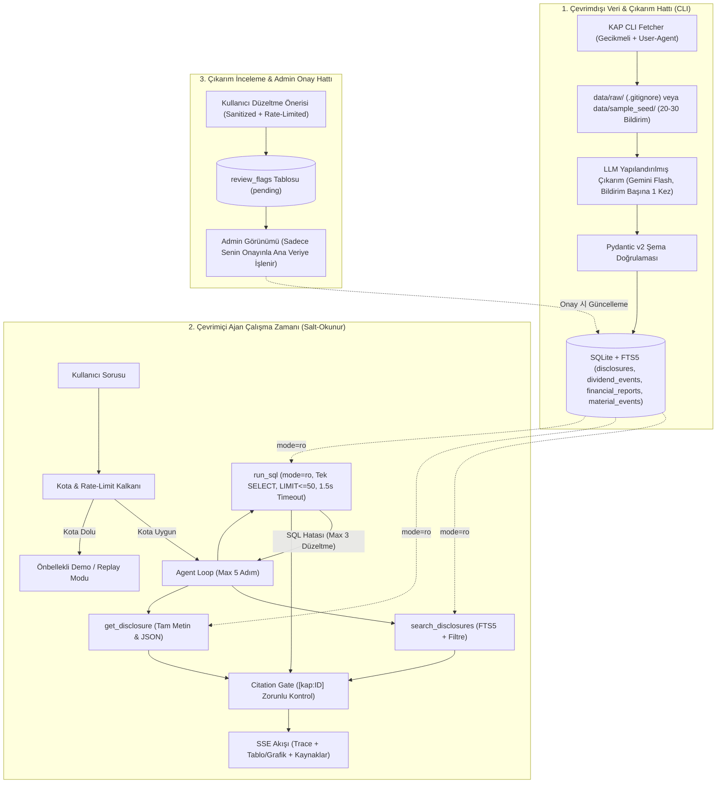

# KAP Agent — Teknik Spesifikasyon (`SPEC.md` — Güncellenmiş Sürüm)

> [!IMPORTANT]
> **Kapsam ve Sorumluluk Sınırı:** Bu sistem yalnızca Kamuyu Aydınlatma Platformu (KAP) bildirimlerini yapılandırılmış veriye dönüştürür ve kaynak bildirim ID'leriyle doğrulanabilir yanıtlar üretir. **Yatırım danışmanlığı veya al-sat önerisi vermez.** Kaynak bildirimle desteklenmeyen hiçbir iddia yanıta dahil edilmez.

---

## 1. Onaylanan Mimari Kararlar Özeti

1. **Veritabanı ve Salt-Okunur İzolasyon (`SQLite + FTS5`):**
   - Veritabanı motoru **SQLite + FTS5** (tam metin arama) olarak sabitlenmiştir.
   - Uygulama içinde **iki ayrı bağlantı katmanı** bulunur:
     - **Ajan Bağlantısı (`readonly_agent_conn`):** `file:...?mode=ro` URI kipi + `PRAGMA query_only = ON` ile açılır. `run_sql` aracı yalnızca bu bağlantıyı kullanabilir ve **sadece tek bir `SELECT` ifadesi** çalıştırabilir.
     - **Uygulama Bağlantısı (`app_write_conn`):** Yalnızca çevrimdışı veri yükleme CLI'ı ve `review_flags` (kullanıcı düzeltme önerileri) tablosu için kullanılır; ajanın bu bağlantıya erişimi yoktur.
2. **Şirket ve Bildirim Kapsamı (BIST 30 — Bankalar Hariç):**
   - BIST 30 içinden seçili **15–20 reel sektör (sanayi/havacılık/perakende/enerji/teknoloji) şirketi**, son **1–2 yıl** (yaklaşık 300–500 bildirim).
   - **Bankalar (`GARAN`, `AKBNK`, `ISCTR`, `YKBNK` vb.) ilk sürümde finansal rapor şemasından hariçtir** (BDDK banka bilanço/gelir tablosu kalemleri standart TMS/TFRS reel sektör şemasından farklı olduğu için).
   - Örnek hedef şirket listesi: `THYAO`, `TUPRS`, `FROTO`, `ASELS`, `BIMAS`, `EREGL`, `SISE`, `TCELL`, `TTKOM`, `KCHOL`, `SAHOL`, `TOASO`, `ARCLK`, `MGROS`, `PGSUS`, `ENKAI`, `ASTOR`, `KONTR`.
3. **Veri Çekici CLI, `.gitignore` ve Küçük Örnek Set (`sample_seed`):**
   - Çekici CLI (`fetcher.py`): İstekler arası gecikmeli (`--delay-sec 2.5` + rastgele jitter), yerel disk önbellekli ve açık `User-Agent` başlıklı olarak çalışır. (KAP kullanım şartları kontrolü kullanıcı tarafından yapılacaktır).
   - `data/raw/`, `data/extractions/` ve tam boyutlu `data/kap_agent.db` **`.gitignore` içindedir** (repoya gönderilmez).
   - Repoya yalnızca **20–30 bildirimlik küçük örnek veri seti (`data/sample_seed/`)** eklenir; tüm `pytest`/`vitest` testleri ve varsayılan canlı demo bu örnek set üzerinden çalışır.
4. **Düzeltme Kuyruğu (`review_flags`), Girdi Temizleme ve Admin Onayı:**
   - Arayüzden gelen düşük güven / hata bildirimleri **ana veriyi asla değiştirmez**; ayrı `review_flags` tablosuna `status = 'pending'` olarak yazılır.
   - Gönderim uç noktasında sıkı **rate-limit** ve **girdi temizleme (input sanitization)** uygulanır.
   - Önerilen düzeltmelerin onaylanması (`approved`) veya reddedilmesi (`rejected`) yalnızca admin anahtarıyla korunan **Admin Görünümü** üzerinden senin tarafından yapılır.

---

## 2. Sistem Mimarisi ve Veri Akışı



---

## 3. Klasör Yapısı (`c:\Users\Windows\Desktop\kap-agent`)

```text
kap-agent/
├── AGENTS.md                       # Antigravity / Claude Code için proje kuralları
├── SPEC.md                         # Bu teknik spesifikasyon dokümanı
├── README.md                       # Mimari, kurulum, eval öncesi/sonrası ve sınırlar
├── .gitignore                      # data/raw/, data/extractions/, data/*.db, .env hariç tutar
├── backend/
│   ├── pyproject.toml              # Python bağımlılıkları ve pytest ayarları
│   ├── app/
│   │   ├── main.py                 # FastAPI uygulaması, CORS, global rate-limit
│   │   ├── config.py               # Ortam değişkenleri (GEMINI_API_KEY, ADMIN_TOKEN, limitler)
│   │   ├── db/
│   │   │   ├── connection.py       # get_readonly_agent_conn (mode=ro) ve get_write_conn
│   │   │   ├── schema.sql          # Ana tablolar, FTS5 sanal tablosu ve review_flags
│   │   │   └── seed_loader.py      # data/sample_seed/ verisini SQLite'a yükleyen betik
│   │   ├── schemas/
│   │   │   ├── base.py             # DisclosureMetadata ve ortak tipler
│   │   │   ├── dividend.py         # DividendExtraction (Temettü)
│   │   │   ├── financial.py        # FinancialReportExtraction (Banka dışı finansal rapor)
│   │   │   ├── material_event.py   # MaterialEventExtraction (Özel durum açıklaması)
│   │   │   └── review.py           # ReviewFlagCreate (girdi temizlemeli) ve Admin karar modelleri
│   │   ├── llm/
│   │   │   ├── base.py             # Tekil LLMProvider protokolü (sağlayıcı bağımsız)
│   │   │   └── gemini.py           # Gemini Flash ücretsiz katman adaptörü (backoff destekli)
│   │   ├── pipeline/
│   │   │   ├── fetcher.py          # Gecikmeli, önbellekli, User-Agent'lı KAP CLI çekici
│   │   │   └── extractor.py        # Toplu (batch), önbellekli LLM -> Pydantic çıkarıcı CLI
│   │   ├── agent/
│   │   │   ├── orchestrator.py     # Tool-calling döngüsü + max 3 SQL self-healing
│   │   │   ├── tools.py            # search_disclosures, get_disclosure, run_sql
│   │   │   ├── sql_guard.py        # Tek SELECT kilidi, yasaklı kelime/token kontrolü, LIMIT/timeout
│   │   │   ├── citation_gate.py    # Kaynak [kap:ID] doğrulayıcı
│   │   │   └── prompts.py          # Sistem istemleri (al-sat önerisi yasağı + şema özeti)
│   │   ├── api/
│   │   │   ├── routes_chat.py      # POST /api/chat (SSE streaming + demo fallback)
│   │   │   ├── routes_disclosures.py # GET /api/disclosures/{id}
│   │   │   └── routes_reviews.py   # POST /api/reviews (halk) + /api/admin/reviews (admin)
│   │   └── mcp/
│   │       └── server.py           # İnce MCP sunucu katmanı
│   └── tests/                      # pytest test paketi (şema, sql_guard, agent, review sanitization)
├── data/
│   ├── sample_seed/                # Repoya dahil edilen 20-30 bildirimlik örnek veri seti
│   │   ├── raw/                    # 20-30 örnek bildirim (kaynak URL + yayın zamanı ile)
│   │   └── extractions/            # Örnek bildirimlerin doğrulanmış Pydantic JSON çıkarımları
│   ├── raw/                        # [GITIGNORE] CLI ile çekilen 300-500 tam bildirim önbelleği
│   └── extractions/                # [GITIGNORE] Tam bildirim çıkarım önbelleği
├── evals/
│   ├── extraction_gold.jsonl       # ~50 bildirimlik çıkarım eval seti ("verified": false ön taslak)
│   ├── agent_gold.jsonl            # ~30 soruluk agent eval seti ("verified": false ön taslak)
│   ├── run_extraction_eval.py      # Çıkarım doğruluk raporu üreteci
│   └── run_agent_eval.py           # Agent SQL başarısı, retry sayısı, kaynak ve gecikme ölçümü
└── frontend/
    ├── package.json
    ├── vite.config.ts
    ├── src/
    │   ├── components/
    │   │   ├── ChatPanel.tsx       # Streaming sohbet + örnek sorular (demo modu)
    │   │   ├── TracePanel.tsx      # Tool çağrıları ve SQL self-healing adımları
    │   │   ├── DataVisualizer.tsx  # Sonuç tablosu ve basit karşılaştırma grafiği
    │   │   ├── SourceDrawer.tsx    # Yan panel: kaynak bildirim metni, URL ve çıkarılan alanlar
    │   │   ├── FlagModal.tsx       # Düşük güvenli çıkarımı işaretleme ve düzeltme önerme formu
    │   │   └── AdminReviewDrawer.tsx # Admin token ile bekleyen düzeltmeleri onaylama/reddetme ekranı
    │   └── ...
    └── tests/                      # vitest arayüz testleri
```

---

## 4. Veritabanı Şeması (`SQLite + FTS5`) ve Pydantic Modelleri

### 4.1. SQLite Tablo Yapısı (`schema.sql`)
1. **`disclosures` (Ana Bildirim Tablosu):**
   - `disclosure_id TEXT PRIMARY KEY`
   - `ticker TEXT NOT NULL` (İndeksli)
   - `company_name TEXT NOT NULL`
   - `disclosure_type TEXT NOT NULL CHECK(disclosure_type IN ('dividend', 'financial_report', 'material_event'))`
   - `published_at TEXT NOT NULL` (ISO-8601, İndeksli)
   - `source_url TEXT NOT NULL`
   - `title TEXT NOT NULL`
   - `summary_tr TEXT NOT NULL`
   - `raw_text TEXT NOT NULL`
   - `extracted_json TEXT NOT NULL`
   - `extraction_confidence REAL NOT NULL`
   - `low_confidence_fields TEXT NOT NULL` (JSON dizisi)
   - `is_banking_entity INTEGER NOT NULL DEFAULT 0 CHECK(is_banking_entity = 0)`
2. **`disclosures_fts` (FTS5 Sanal Tablosu):**
   - `CREATE VIRTUAL TABLE disclosures_fts USING fts5(disclosure_id UNINDEXED, ticker, title, summary_tr, raw_text, tokenize='unicode61 remove_diacritics 2');`
3. **`dividend_events` (Temettü Tablosu):**
   - `disclosure_id TEXT PRIMARY KEY REFERENCES disclosures(disclosure_id)`
   - `ticker TEXT NOT NULL`, `fiscal_year INTEGER NOT NULL`, `decision_status TEXT NOT NULL`
   - `gross_cash_per_share_try REAL`, `net_cash_per_share_try REAL`, `total_gross_cash_dividend_try REAL`
   - `bonus_share_rate_pct REAL`, `payment_type TEXT`, `ex_dividend_date TEXT`, `payment_date TEXT`, `evidence_quote TEXT NOT NULL`
4. **`financial_reports` (Banka Dışı Finansal Rapor Tablosu):**
   - `disclosure_id TEXT PRIMARY KEY REFERENCES disclosures(disclosure_id)`
   - `ticker TEXT NOT NULL`, `period TEXT NOT NULL` (`YYYY/03|06|09|12`), `consolidation TEXT NOT NULL`
   - `presentation_scale TEXT NOT NULL`, `revenue_try REAL`, `gross_profit_try REAL`, `ebitda_try REAL`, `operating_profit_try REAL`, `net_profit_try REAL`, `total_assets_try REAL`, `total_equity_try REAL`, `net_debt_try REAL`, `evidence_quote TEXT NOT NULL`
5. **`material_events` (Özel Durum Açıklaması Tablosu):**
   - `disclosure_id TEXT PRIMARY KEY REFERENCES disclosures(disclosure_id)`
   - `ticker TEXT NOT NULL`, `event_category TEXT NOT NULL`, `counterparty TEXT`
   - `contract_amount_original REAL`, `contract_currency TEXT`, `contract_amount_try_equiv REAL`, `revenue_ratio_pct REAL`, `expected_impact TEXT`, `evidence_quote TEXT NOT NULL`
6. **`review_flags` (Kullanıcı Düzeltme Kuyruğu — `run_sql` Tarafından Sorgulanamaz):**
   - `flag_id INTEGER PRIMARY KEY AUTOINCREMENT`
   - `disclosure_id TEXT NOT NULL REFERENCES disclosures(disclosure_id)`
   - `field_name TEXT NOT NULL`
   - `current_value TEXT`
   - `suggested_value TEXT NOT NULL`
   - `reason_note TEXT`
   - `reporter_ip_hash TEXT NOT NULL`
   - `status TEXT NOT NULL DEFAULT 'pending' CHECK(status IN ('pending', 'approved', 'rejected'))`
   - `created_at TEXT NOT NULL`
   - `reviewed_at TEXT`

---

## 5. Araç Sözleşmeleri ve `run_sql` Güvenlik Kuralları

### 5.1. `search_disclosures`
- `disclosures_fts` (FTS5) ve `disclosures` filtrelerini (`ticker`, `disclosure_type`, `date_from`, `date_to`, `query`, `limit<=25`) kullanarak ilgili bildirim özetlerini döndürür.

### 5.2. `get_disclosure`
- `disclosure_id` ile tek bir bildirimin üst verisini, çıkarılmış yapılandırılmış JSON alanlarını, `source_url` bilgisini ve orijinal metnini döndürür.

### 5.3. `run_sql` (Sıkılaştırılmış Tek `SELECT` Sandbox'ı)
- **Ayrı Salt-Okunur Bağlantı:** `sqlite3.connect("file:.../kap_agent.db?mode=ro", uri=True)` + `PRAGMA query_only = ON`.
- **Sadece Tek `SELECT` İfadesi:**
  1. Sorgu başındaki/sonundaki boşluklar ve tek bir sondaki `;` temizlendikten sonra içinde `;` varsa anında reddedilir (çoklu ifade engeli).
  2. Sorgu büyük/küçük harf duyarsız olarak **yalnızca `SELECT` kelimesiyle** başlamalıdır (`WITH`, `INSERT`, `UPDATE`, `DELETE`, `DROP`, `ALTER`, `CREATE`, `ATTACH`, `DETACH`, `PRAGMA`, `VACUUM`, `REPLACE` ifadeleri token düzeyinde reddedilir).
  3. `review_flags` veya `sqlite_master` gibi sistem/yönetim tablolarına erişim engellenir; yalnızca 4 beyaz liste tablosu (`disclosures`, `dividend_events`, `financial_reports`, `material_events`) sorgulanabilir.
  4. **Zorunlu `LIMIT`:** Sorguda `LIMIT` yoksa sonuna otomatik `LIMIT 50` eklenir; `LIMIT > 50` ise `50`'ye indirilir.
  5. **Zaman Aşımı:** SQLite `set_progress_handler` ile sorgu süresi `1500ms` (1.5 saniye) aştığında `OperationalError("Query timeout exceeded")` fırlatılır.
- **Self-Healing (Kendi Kendini Düzeltme):**
  - SQL hatası veya şema uyumsuzluğu durumunda ajan hatayı ve tablo sütun listesini okuyarak sorguyu **en fazla 3 kez** (`max_sql_retries = 3`) yeniden yazar.

---

## 6. Düşük Güvenli Çıkarım İşaretleme, Girdi Temizleme ve Admin Onayı

1. **Girdi Temizleme (`backend/app/schemas/review.py`):**
   - `field_name`: Yalnızca ilgili şemadaki geçerli alan adları beyaz listesinden (whitelist) biri olabilir.
   - `suggested_value` (maks. 120 karakter) ve `reason_note` (maks. 400 karakter): Kontrol karakterleri ve tüm HTML/script etiketleri (`<...>`) temizlenir (`strip` + regex/escape).
2. **Rate Limit:**
   - `POST /api/reviews` uç noktasında IP başına **dakikada en fazla 5, günde 20** düzeltme önerisi sınırı uygulanır.
3. **Admin Görünümü ve Onay Akışı:**
   - Arayüzde sağ üstteki kilit ikonundan `ADMIN_TOKEN` girildiğinde **Admin İnceleme Paneli** açılır.
   - Bekleyen (`pending`) düzeltmeler orijinal KAP metni ve mevcut değerle yan yana listelenir.
   - Yalnızca sen **"Onayla"** dediğinde (`POST /api/admin/reviews/{flag_id}/approve`), ilgili bildirim kaydındaki alan güncellenir, `human_verified = 1` işaretlenir ve `review_flags.status = 'approved'` olur.

---

## 7. Eval Tasarımı (`verified: false` Ön Taslak Kuralı)

- **`evals/extraction_gold.jsonl` (~50 bildirim):** 3 bildirim türünden (temettü, banka dışı finansal rapor, özel durum) seçilmiş ~50 örnek. Ön taslak çıkarımlar `"verified": false` olarak üretilir; senin kontrolünden geçenler `"verified": true` olur.
- **`evals/agent_gold.jsonl` (~30 soru):**
  - Tekil bildirim bulma, çoklu şirket SQL karşılaştırması, kasıtlı zorlayıcı SQL sorguları (self-healing testi), veri setinde olmayan şirket soruları (uydurmama testi) ve yatırım tavsiyesi soruları (*"FROTO alınır mı?"* → reddetme testi).
  - Raporlanan metrikler: **İlk Denemede SQL Başarısı (%)**, **Ortalama SQL Düzeltme Sayısı**, **Kaynak Doğruluğu (Citation Precision/Recall %)**, **Guardrail Başarısı (%)** ve **Gecikme (p50/p95 ms)**.

---

## 8. Uygulama Aşamaları

1. **Aşama 1 — Veri ve Çıkarım:** `kap-agent` repo iskeleti (`AGENTS.md`, `SPEC.md`, `.gitignore`), Pydantic şemaları, gecikmeli/önbellekli/User-Agent'lı `fetcher.py` CLI, 20–30 bildirimlik `data/sample_seed/` veri seti, Gemini Flash çıkarıcı, SQLite + FTS5 şeması ve `pytest` birim testleri.
2. **Aşama 2 — Agent ve Eval:** Sağlayıcı bağımsız `LLMProvider`, `search_disclosures` / `get_disclosure` / tek-SELECT `run_sql` + self-healing döngüsü, `[kap:ID]` kaynak doğrulayıcı ve `verified: false` etiketli eval betikleri.
3. **Aşama 3 — Web Arayüzü ve Admin Paneli:** Streaming sohbet, canlı Tool/SQL Trace paneli, sonuç tablosu/grafik, yan panel kaynak bildirim görüntüleyici, girdi temizlemeli düzeltme öneri formu + Admin onay görünümü ve `vitest` testleri.
4. **Aşama 4 — Sertleştirme, MCP ve Yayın:** Kota koruma + örnek sorularla Demo/Replay modu, ince MCP sunucusu ve mimari/eval sonuçlarını içeren `README.md`.
